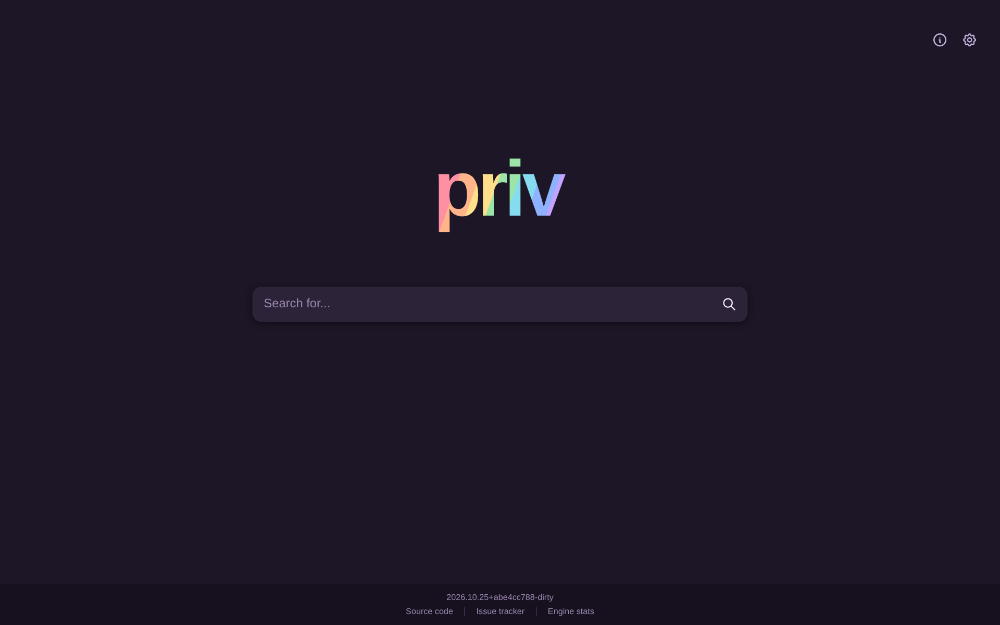
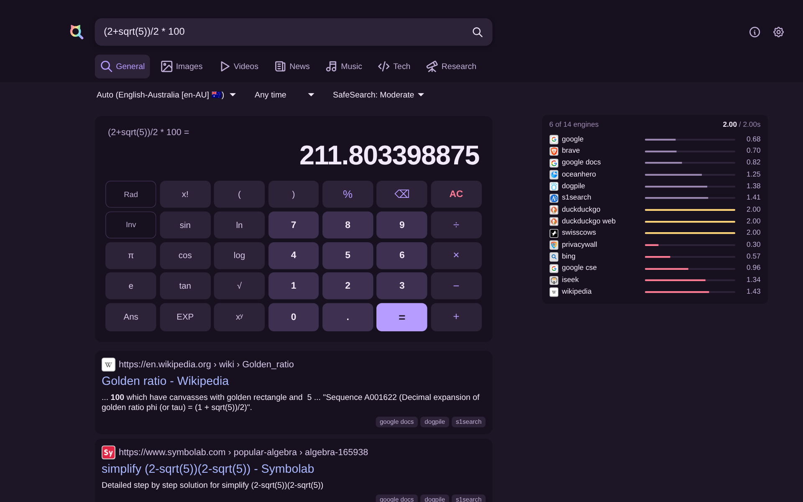
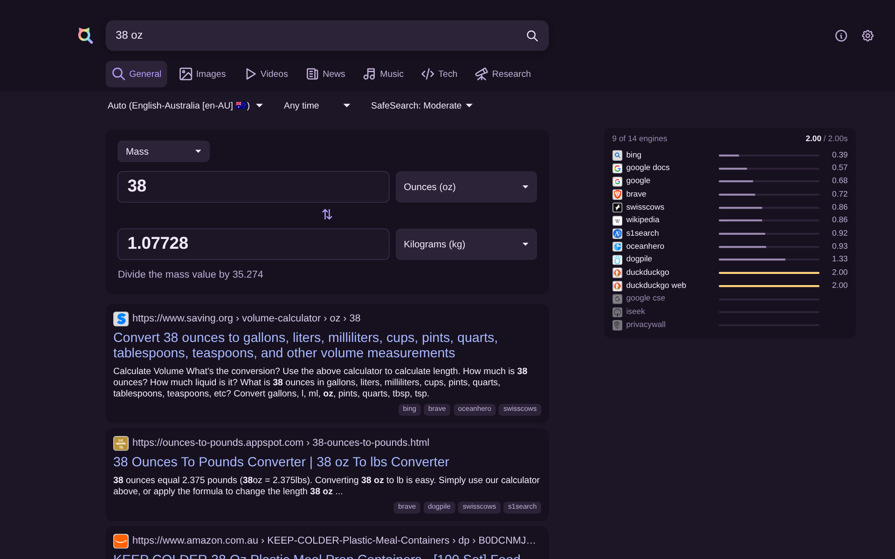
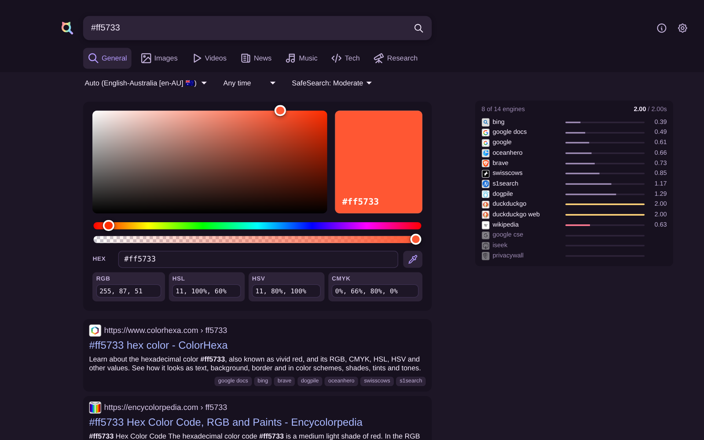
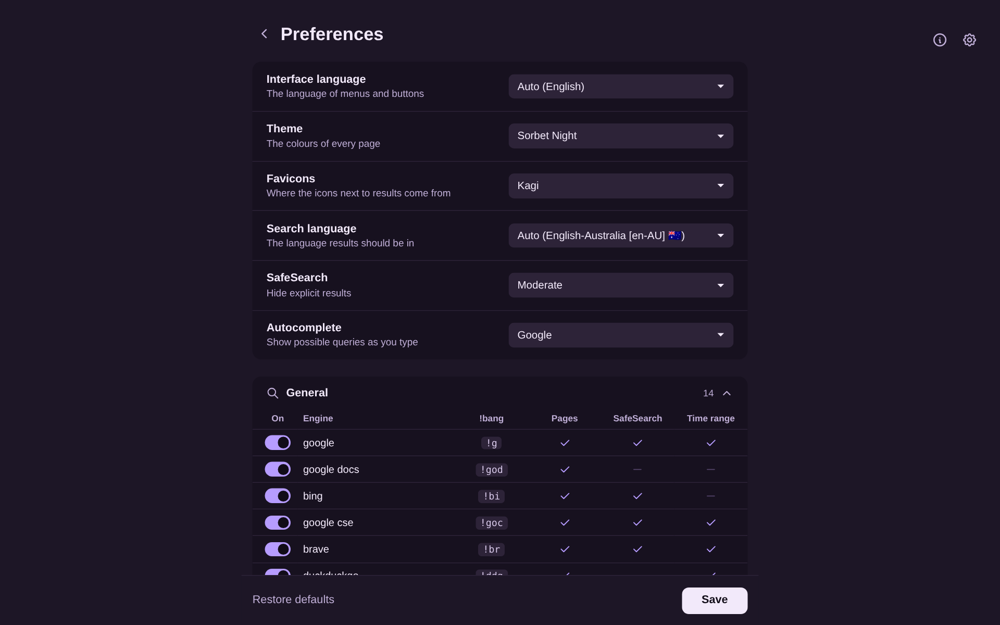
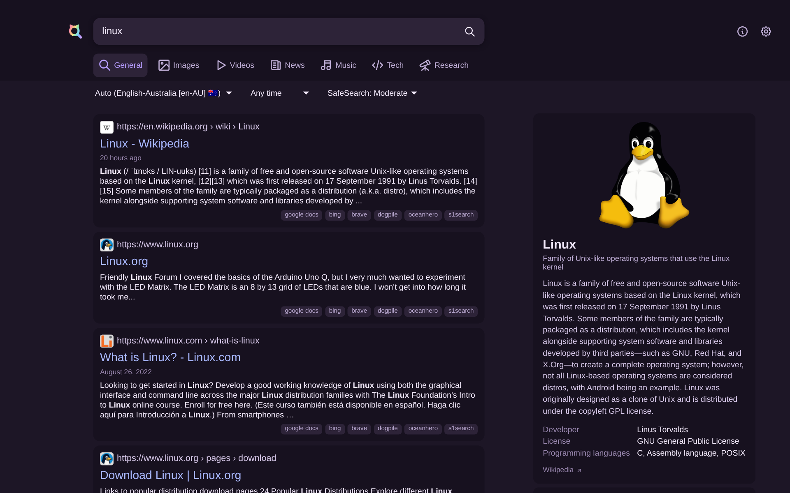
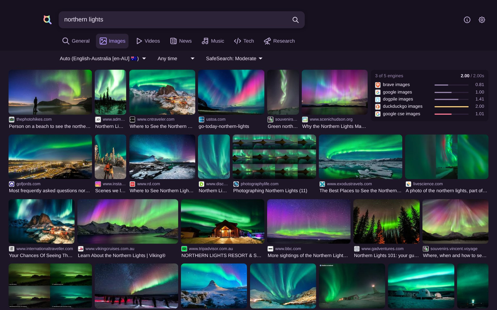

# priv

A minimal metasearch engine in C. Works without JS sans a few niceties.

I have been a bit disappointed with the memory usage and speed of SXNG (i.e. such as when ranking many results). This is probably due to the nature of an interpreted language.

For priv, I have put performance at the forefront. I have made many micro optimisations and also gave the UI a small refresh in a way I've always wanted to do but never had the tools to do it. More updates will be on the way.

This whole project has been made possible through the use of LLMs (AI assisted development) - please note this is still very much in beta and may have bugs despite me taking care for it not to.

## Screenshots

<table>
<tr>
<td width="50%"> Calculator</td>
<td width="50%"> Unit converter</td>
</tr>
<tr>
<td width="50%"> Colour picker</td>
<td width="50%"> Preferences</td>
</tr>
<tr>
<td width="50%"> Web results</td>
<td width="50%"> Images</td>
</tr>
</table>

## Run

    docker run -d --name priv -p 127.0.0.1:8888:8888 -v priv-cache:/cache ghcr.io/vojkovic/priv:latest

Then open http://127.0.0.1:8888 in your browser

## Configure

Make priv yours!

You can edit the `config.toml` to change things such as the instance name, listen address, timeouts, bot detection and which engines are on.

    curl -o config.toml https://raw.githubusercontent.com/vojkovic/priv/master/config.toml
    docker run -d --name priv -p 127.0.0.1:8888:8888 -v priv-cache:/cache -v ./config.toml:/etc/priv/config.toml:ro ghcr.io/vojkovic/priv:latest

## Develop

    make format
    make format-check
    make lint          # clang-tidy and cppcheck

## Search syntax

Most of the bangs are supported:

- `!g`, `!br`, `!yt` (or `!google_images` by name) (and `!!g` to redirect)
- `!images`, `!videos`, `!news`, `!music`, `!tech`, `!research` a whole category
- `:de`, `:en-AU`, `:german`, `:deutschland` the search language
- `<3` a timeout of 3 seconds max

## Engines so far

| category | engines |
| --- | --- |
| general | google, google docs, bing, google cse, brave, duckduckgo, duckduckgo web, dogpile, qwant, tusksearch, wiktionary, privacywall, oceanhero, swisscows, iseek, s1search, wikipedia |
| images | google images, google cse images, brave images, duckduckgo images, dogpile images, tusksearch images |
| videos | google videos, duckduckgo videos, youtube, brave videos, bing videos, dailymotion |
| news | google news, duckduckgo news, reuters, brave news, abc news, bing news, wikinews |
| music | soundcloud, wikicommons audio, genius, mixcloud, radio browser, abc radio |
| tech | arch linux wiki, mdn, mankier, pypi, stackoverflow, askubuntu, superuser |
| research | arxiv, europepmc, pdbe, pubmed, openalex, crossref, google scholar |
